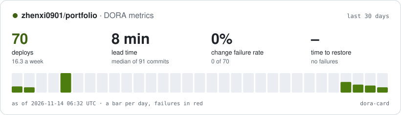

# dora-card

The four [DORA metrics](https://dora.dev/guides/dora-metrics/) for any repository that deploys with GitHub Actions, as a card for its README. No dependencies, no service to run: a GitHub Action reads your deploy workflow's history and writes an SVG.

<picture>
  <source media="(prefers-color-scheme: dark)" srcset="https://raw.githubusercontent.com/zhenxi0901/dora-card/output/dora-dark.svg" />
  <source media="(prefers-color-scheme: light)" srcset="https://raw.githubusercontent.com/zhenxi0901/dora-card/output/dora-light.svg" />
  
</picture>

That card is my [portfolio](https://github.com/zhenxi0901/portfolio)'s own deploy history, redrawn every six hours by this repository's [card workflow](.github/workflows/card.yml).

## Use it

Add a workflow that measures on a schedule and publishes the card to a branch of its own. It has two jobs, so that the action, which is code from another repository, runs with a read-only token, and the job that can push runs nothing but GitHub's own actions and git:

```yaml
name: dora-card
on:
  schedule: [{ cron: "41 */6 * * *" }] # not on the hour: that is when GitHub's scheduled runs queue the longest
  workflow_dispatch:
permissions: {}
concurrency:
  group: dora-card
  cancel-in-progress: true
jobs:
  measure:
    runs-on: ubuntu-latest
    timeout-minutes: 10
    permissions:
      actions: read # the deploy workflow's runs
      contents: read # the commits each deploy shipped
    outputs:
      deploys: ${{ steps.dora.outputs.deploys }}
    steps:
      - id: dora
        uses: zhenxi0901/dora-card@95c72ecb76b91794d1d43704992aed9635d27204 # v1.1.0 (a commit SHA can't move; @v1 follows the latest 1.x)
        with:
          workflow: deploy.yml
      - uses: actions/upload-artifact@cf430e030ddbb5b0abf93d22962f4752f3646cd9 # v7.0.2
        with:
          name: dora-card
          path: dora/
          retention-days: 1

  publish:
    needs: measure
    runs-on: ubuntu-latest
    timeout-minutes: 5
    permissions:
      contents: write # push the card to the dora-card branch
    steps:
      - uses: actions/checkout@3d3c42e5aac5ba805825da76410c181273ba90b1 # v7.0.1
      - uses: actions/download-artifact@9000827ccba6bdab643e8b6fd33ac0654aef8333 # v8.0.2
        with:
          name: dora-card
          path: ${{ runner.temp }}/dora-card
      - name: Publish the card to the dora-card branch
        env:
          DEPLOYS: ${{ needs.measure.outputs.deploys }}
        run: |
          git switch --orphan dora-card
          cp "$RUNNER_TEMP"/dora-card/* .
          git add dora-dark.svg dora-light.svg dora.json
          git -c user.name="github-actions[bot]" -c user.email="41898282+github-actions[bot]@users.noreply.github.com" \
            commit -q -m "DORA card: $DEPLOYS deploys"
          git push -q --force origin dora-card
```

Pin `zhenxi0901/dora-card` to a release's full commit SHA, as the other actions here are, rather than to `@v1`: a tag can be moved to point at other code, a SHA can't. Values from expressions reach the shell through `env:`, never as `${{ }}` inside `run:`.

Then show it in your README, in both themes:

```html
<picture>
  <source media="(prefers-color-scheme: dark)" srcset="https://raw.githubusercontent.com/OWNER/REPO/dora-card/dora-dark.svg" />
  
</picture>
```

## Inputs

| Input | Default | What it does |
|---|---|---|
| `workflow` | (required) | The deploy workflow's file name, such as `deploy.yml`. |
| `repository` | this repository | The repository to measure, as `owner/name`. |
| `branch` | the default branch | Only runs on this branch count. Left empty, it is the repository's default branch, which costs one request. |
| `job` | the whole run | Judge each run by this job alone, for a workflow that also tests, releases or cleans up. It is the job's display name: its `name:`, or its key if it has none. Matrix jobs such as `deploy (prod)` count as `deploy`. |
| `event` | any | Only runs started by this event, such as `push` or `workflow_run`: leaves out manual runs and drills. |
| `window-days` | `30` | How far back to measure, 1 to 365 days. |
| `title` | the repository | The card's title. |
| `output-dir` | `dora` | Where `dora.json`, `dora-dark.svg` and `dora-light.svg` go. |
| `token` | `github.token` | Reads the runs and commits. For another private repository, a token with `actions: read` and `contents: read` there. |

Outputs: `deploys`, `deploys-per-week`, `lead-time-hours`, `change-failure-rate` and `time-to-restore-hours`, and the same numbers in the job summary.

The action warns, with an annotation on the run, when no runs match the workflow, branch and event; when `job` is set but no run has a job of that name (the warning lists the names it found); when it can't compare two deploys; and when it stops reading runs early.

## What it measures

- **Deployment frequency:** successful deploys in the window, per week.
- **Lead time for changes:** for every commit that a deploy in the window shipped, the time from its commit to the end of that deploy; the median. A commit made before the window opened counts too, with its whole wait. Which commits a deploy shipped comes from comparing it with the deploy before it, so a redeploy ships nothing and a commit is never counted twice.
- **Change failure rate:** failed deploys over all deploys (successful and failed) in the window. Every failed deploy counts, each of several in a row included. A run that times out is a failure; a cancelled or skipped one did not deploy.
- **Time to restore:** for each incident, the time from its first failed deploy until the next successful one finished; the median. Failed deploys in a row are one incident: fail, fail again an hour later, succeed an hour after that is one two-hour incident (and two failures in the change failure rate).
- **Re-runs:** every attempt counts. A deploy that failed and then passed on "Re-run failed jobs" is a failed deploy followed by a successful one: it shows in the change failure rate, and the wait for the re-run is its time to restore.

The bars are UTC days, from the day the window opens, partway through, to today: a 30-day card has 31 bars, so every deploy counted has one.

## What it does not know

- It treats a deploy run as a change. DORA's change failure rate counts changes that hurt production, including ones whose deploy succeeded and was later rolled back by hand; a workflow can't see those. If your pipeline rolls back on its own, a failed run is close to the real thing.
- Restore time is from the first failed run of an incident to the next good one, not from when users were affected.
- Lead time uses commit time (the committer date), so a branch that sat unmerged for a week counts that week.
- A comparison returns at most 250 commits, so a single deploy of more than 250 commits counts the newest 250.
- If a deployed commit has gone (a force-push, then garbage collection), comparing it fails, and that deploy's commits are left out of the lead time, with a warning.

My portfolio's own pipeline computes richer versions of these (automatic rollbacks, drills, per-commit lead time in its changelog); this action is the part of that which works for any repository.

## How it works

`src/main.mjs` takes the branch (the input, or the repository's default), then lists the deploy workflow's completed runs on it, newest first, back to the last deploy before the window. With `job` set it reads each run's jobs, from every attempt; a skipped run ran no jobs and is not read. Without `job`, it reads a re-run's earlier attempts. It asks the compare API which commits each deploy added, then `src/dora.mjs` computes the metrics and `src/card.mjs` draws the cards.

GitHub stops a filtered list of runs at 1,000, so after ten pages the listing starts again from the oldest run read so far (`created=<=` its time). It stops, with a warning, after 5,000 runs. Requests go four at a time, and each has 30 seconds to answer. One that gets a 5xx, a 429 or a secondary rate limit is tried up to three more times, after waiting as long as GitHub's `retry-after` asks, or 1, 2 and 4 seconds.

That costs about two requests per deploy in the window with `job` set (its jobs and a comparison) or one without, plus one for every 100 runs listed and one to look up the default branch. GITHUB_TOKEN allows 1,000 requests an hour per repository, which covers hundreds of deploys a month.

```sh
node --test   # the metrics, the card, the API client and the action end to end, against a fake API
```

## Changes in 1.1.0

The same history can give different numbers than 1.0.0 did:

- Lead time counts every commit a deploy in the window shipped. 1.0.0 left out the ones committed before the window opened.
- Time to restore counts failed deploys in a row as one incident, timed from the first failure.
- Every attempt of a re-run counts, so a failure fixed by "Re-run failed jobs" is no longer lost.
- With `job` set, each run is judged by that job's own result, even when a later job was cancelled, and the last deploy before the window is found the same way. `job` also matches matrix jobs such as `deploy (prod)`.
- `branch` defaults to the repository's default branch instead of `main`.
- The card has a bar for the window's first, partial day.

It is also sturdier and faster: lists of more than 1,000 runs are read in full; requests are retried, time-limited and made four at a time (my portfolio's card took 18 seconds instead of 66); a comparison that fails is skipped with a warning instead of failing the run; and the action warns when nothing matches.

## License

MIT
